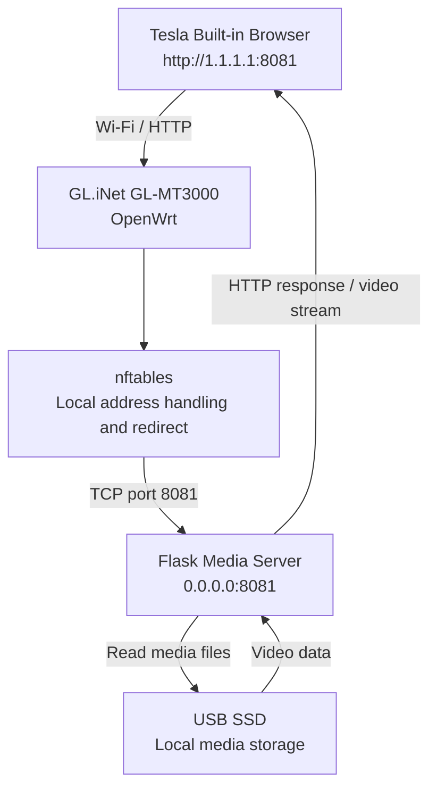
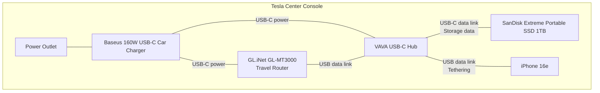

# Tesla Local Self-Hosted Media Server

A lightweight, self-hosted media server for playing locally stored videos in Tesla's built-in browser.

Designed for travel routers running OpenWrt, this project provides a web-based media library served directly from local storage. The entire setup is designed to fit inside the center console compartment, without requiring a public hostname, DDNS, or an externally hosted server.

## Features

- **Tesla browser compatibility** — Access the media server through a browser-compatible address using router-side address translation.
- **Self-contained setup** — The media server runs directly on the travel router using Python and Flask.
- **Local media playback** — Stream videos directly from USB storage connected to the travel router.
- **No public hostname or DDNS required** — No DuckDNS, dynamic public IP tracking, or external DNS configuration.
- **No server-side transcoding** — Videos are served directly to the browser without requiring FFmpeg or other server-side transcoding.
- **HTTP Range Requests** — Supports standard and suffix byte-range requests for video playback and seeking.
- **Automatic next video** — Automatically plays the next video in alphabetical order for binge-watching.
- **Directory browsing** — Browse media files organized in directories.

## Motivation

Tesla's infotainment system provides access to streaming platforms such as YouTube and Netflix. However, playing personal video collections directly from USB storage is not straightforward.

This project enables local media playback through a media server running on 
a travel router, using router-side address translation to make 
locally stored videos accessible through Tesla's built-in browser.

## Requirements

- A travel router running OpenWrt.
- Tesla built-in browser.
- Power supply inside the car.
- A tethering device ([see In-Vehicle Hardware Setup](#in-vehicle-hardware-setup)).
- (Optional) USB storage for video files.

## Installation

#### Prerequisites

As the application runs directly on the travel router, the first step is to copy this repository to the router.

- Connect your laptop to the router's Wi-Fi network.
- `scp` this repository to the router.
- `ssh` into the router.

#### Setup

On the router, run the following script. This installs the required OpenWrt packages, 
creates configured media directories, registers the service, and starts it.

The default anchor IP is `1.1.1.1`. This IP is used throughout this document but is 
configurable by changing `ANCHOR_IP` in `bin/config.sh`.


```sh
cd /opt/media-server-openwrt
chmod +x bin/*.sh
./bin/setup.sh
```

#### Storage mount

Optionally, configure the USB storage mount location as the media directory through `VIDEO_DIR` in `.env`.

The USB mount location depends on the router and its mount configuration. On some GL.iNet/OpenWrt systems, USB storage may be mounted under `/tmp/mountd/`.

For testing without USB storage, you can place a short test video in a local directory and configure `VIDEO_TEST_DIR` to point to that directory.

```sh
vi /opt/media-server-openwrt/.env
```

#### Test

Display diagnostics to verify that the media server and network configuration are ready.

```sh
# Display diagnostics
./bin/monitor.sh
```

Then, open the following URL in a laptop browser connected to the travel router's Wi-Fi network. Verify that the media listing is displayed and that videos can be played.

The following video format is known to work:

- MP4 container
- H.264 video
- AAC audio

```text
http://1.1.1.1:8081
```

#### Service management

The media server is managed by the OpenWrt init service:

```sh
# Start, stop, or restart the service
/etc/init.d/ms_route start|stop|restart

# Enable or disable startup at boot
/etc/init.d/ms_route enable|disable
```

The project also provides helper scripts under `/opt/media-server-openwrt/bin` for testing and diagnostics.

```sh
monitor.sh
network.sh apply|ensure|check|cleanup
start.sh
stop.sh
```

## Using the Media Server

1. Connect the Tesla to the travel router's Wi-Fi network.
2. Open the Tesla browser.
3. Navigate to `http://1.1.1.1:8081`.
4. Browse the available media directories.
5. Select a video to start playback.

The built-in HTML5 video player handles playback. The server delivers the original media files without server-side transcoding.

MP4 files containing H.264 video and AAC audio are known to work in the tested setup. Playback compatibility may vary depending on codec profiles, encoding parameters, and Tesla browser version.

## Accessing the Media Server on the Rear Screen

The rear screen does not provide the same browser access as the front infotainment screen. The following is a workaround using the YouTube app:

1. Create a private YouTube video.
2. Add a clickable link to a domain URL in the video's description.
3. Configure that link to lead to a page containing the media server URL: `http://1.1.1.1:8081`.
4. Open the private YouTube video on the front screen.
5. Open its description and click the link to access the media server.
6. On the rear screen, tap YouTube cast icon.

## How It Works

The Tesla browser accesses the media server through a browser-facing address:

`http://1.1.1.1:8081`

The travel router handles this address locally and redirects the intended traffic to the Flask media server.

The address `1.1.1.1` is globally assigned, but in this setup it is configured as a local address on the travel router and handled locally. Requests to this address are redirected to the local Flask media server.

The media server does not connect to Cloudflare or depend on an external service at that address.

The network configuration uses:

1. A local `1.1.1.1/32` address assigned to `br-lan`.
2. A dedicated nftables table for the media server's traffic redirection.
3. A TCP port 8081 redirect to the local Flask server.

This is a local routing arrangement, not a public reverse proxy or an internet-facing media server.

### Request flow



## Tested Hardware and Software

The following hardware, software, and video format have been confirmed to work together in the tested setup.

| Component | Model / Details |
|---|---|
| Vehicle | Tesla Model Y |
| Tesla software | 2026.38.5.12 |
| Power outlet | 12A continuous draw (16A peak) |
| Travel router | GL.iNet GL-MT3000 (Beryl AX) |
| Router OS | OpenWrt |
| Media storage | SanDisk Extreme Portable SSD 1TB |
| USB hub | VAVA USB-C Hub |
| Power adapter | Baseus 160W USB-C Car Charger |
| Tethering device | iPhone 16e |
| Video format | MP4 (H.264 video + AAC audio) |

## In-Vehicle Hardware Setup

The hardware is designed to fit inside the Tesla center console compartment.

The Baseus car charger provides power to both the USB hub and the travel router. The router connects to the hub for USB storage and tethering-device connectivity.

**Caveat:** The media server itself does not require internet access to serve locally 
stored videos. However, in the tested setup, the Tesla does not connect to the 
travel router's Wi-Fi network when the router has no upstream internet connection.
USB tethering to the router therefore allows the Tesla to connect.

#### Connection diagram



## Security Considerations

- The media server is intended for use on the dedicated travel-router network.
- Do not expose the media server port to the public internet.
- The `1.1.1.1` address is handled locally by the travel router in this setup.
- Access to the media server is determined by access to the travel-router Wi-Fi network.

## Limitations
- Tested only with the hardware and Tesla software version listed above.
- Tesla software updates may affect browser compatibility.
- USB tethering is required for the Tesla to connect to the router's Wi-Fi.
- The rear-screen workaround may stop working if Tesla or YouTube changes its behavior.

## Related Projects
- [tesla-carplay](https://github.com/marcraft2/tesla-carplay) — Uses router-side address translation to make a local service accessible through the Tesla browser.
- [moonlight-web-stream-tsla](https://github.com/Argon2000/moonlight-web-stream-tsla) — Streams a remote desktop/game session to Tesla using a web-based approach.
- [opencarstream](https://github.com/santibacat/opencarstream) — Streams video to Tesla using a server-side video-processing approach.
- [Tesla Android](https://github.com/tesla-android/tesla-android.github.io/blob/main/install-guide-2022-18-1.md) — Documents Tesla browser restrictions on accessing private IP addresses and a workaround using a public-range IP address.
